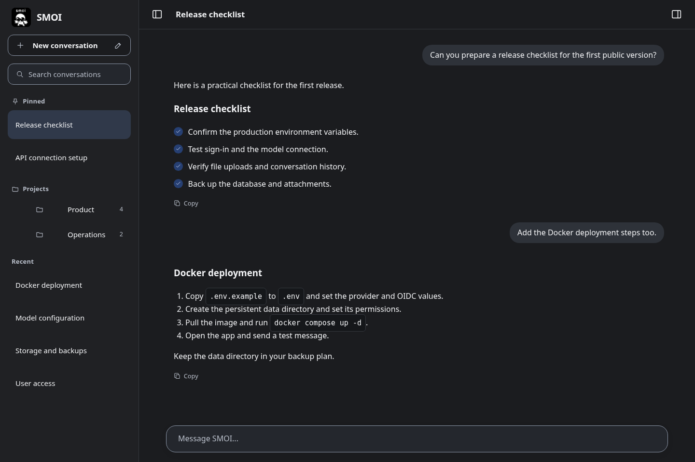
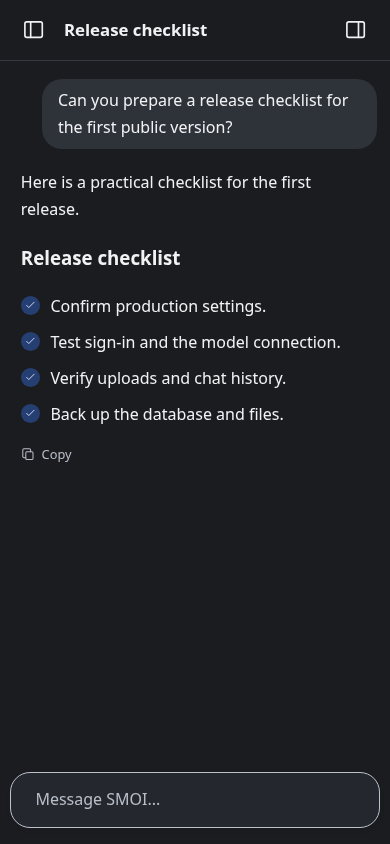

# GitHub repositories are now mirror only

Due to recent changes in GitHub's direction, development has migrated to: https://git.ribas89.co.uk/

Have a issue/question? https://link.ribas89.co.uk/ask


Thank you for your support ❤️!


<p align="center">
  
</p>

<h1 align="center">SMOI - Small Open Webui</h1>

<p align="center">A self-hosted chat application for OpenAI-compatible model APIs.</p>

<p align="center">Sign in with OIDC, keep conversations on your server, and use the models provided by your API endpoint.</p>

<table>
  <tr>
    <th align="center">Desktop</th>
    <th align="center">Mobile</th>
  </tr>
  <tr>
    <td width="72%"></td>
    <td width="28%"></td>
  </tr>
</table>

Screenshots use sample conversations and contain no account data.

## What SMOI includes

- Chat with any provider that supports the OpenAI Chat Completions API.
- OIDC sign-in with Authorization Code and PKCE.
- SQLite conversation and message history, separated by user.
- Background response generation with saved partial responses.
- Stop a response or interrupt it by sending another message.
- File uploads, image paste, drag and drop, and attachment downloads.
- Conversation search, pinned conversations, and project groups.
- Light and dark themes, adjustable text size, and English, Spanish, and Brazilian Portuguese.
- User and storage administration.
- Desktop and mobile layouts.

The first user to sign in is assigned the administrator role. Other users receive the regular user role.

## Technology

- Go 1.24 or newer
- SQLite through `modernc.org/sqlite`
- React 19 and TypeScript
- Vite
- Bootstrap and Bootstrap Icons
- Docker and Docker Compose for deployment

The Go server serves the compiled frontend and the JSON API from one process.

## Project layout

```text
backend/
  cmd/smoi/                 Application startup and frontend routes
  internal/api/             HTTP handlers, chat, attachments, administration
  internal/auth/            OIDC sign-in, users, and sessions
  internal/database/        SQLite queries and database setup
  internal/storage/         Persistent files and cleanup
  internal/upstream/        Model API requests and streaming responses
  migrations/               SQLite schema
  static/                   Embedded frontend files
frontend/
  src/components/           Chat, navigation, preferences, and administration UI
  src/hooks/                Session, chat, models, and conversation state
  src/i18n/                 Interface translations
  src/pages/                Application pages
  src/services/             API requests and formatting
  src/styles/               Application styles
  public/assets/            Logo and browser icons
docs/screenshots/           Desktop and mobile example screenshots
.github/workflows/          Package publishing workflow
```

### docker-compose.yml

```yaml
services:
  smoi:
    image: ghcr.io/ribas89/smoi:latest
    container_name: smoi
    env_file:
      - .env
    ports:
      - "127.0.0.1:8080:8080"
    volumes:
      - "./data:/data"
    extra_hosts:
      - "host.docker.internal:host-gateway"
    restart: unless-stopped
```

The image name, published host port, and host data directory are deployment settings. They are defined directly in Compose so they do not need extra variables in `.env`.

### .env.example

```dotenv
SMOI_HOST=0.0.0.0
SMOI_PORT=8080
SMOI_DATA_DIR=/data
SMOI_DB_PATH=/data/database/smoi.db
SMOI_LOG_LEVEL=info
SMOI_MAX_UPLOAD_MB=25
SMOI_SESSION_DURATION_HOURS=168

OPENAI_BASE_URL=http://host.docker.internal:8000/v1
OPENAI_API_KEY=
OPENAI_DEFAULT_MODEL=example-model
OPENAI_TIMEOUT_SECONDS=0

OIDC_ISSUER_URL=https://identity.example.com
OIDC_CLIENT_ID=smoi-client
OIDC_CLIENT_SECRET=
OIDC_REDIRECT_URL=https://chat.example.com/api/auth/callback
```

Every variable in `.env.example` is read by the SMOI server. Replace the example API endpoint, API key, model name, OIDC issuer, client ID, client secret, and callback URL before deployment. Leave `OPENAI_API_KEY` empty only when the model provider does not require authentication. Leave `OIDC_CLIENT_SECRET` empty only when the identity provider uses a public client.

Do not commit `.env`.

### Environment variables

| Variable | Purpose |
| --- | --- |
| `SMOI_HOST` | Address used by the Go server. Use `0.0.0.0` in the container. |
| `SMOI_PORT` | Port used by the Go server. If you change it from `8080`, update the container port in the Compose `ports` entry as well. |
| `SMOI_DATA_DIR` | Data directory inside the container. |
| `SMOI_DB_PATH` | SQLite database path. It must be inside `SMOI_DATA_DIR`. |
| `SMOI_LOG_LEVEL` | `debug`, `info`, `warn`, or `error`. Default: `info`. |
| `SMOI_MAX_UPLOAD_MB` | Maximum size of one uploaded file. Default: `25`. |
| `SMOI_SESSION_DURATION_HOURS` | Session lifetime in hours. Default: `168`. |
| `OPENAI_BASE_URL` | Model API base URL. The server adds `/v1` if it is missing. |
| `OPENAI_API_KEY` | API key for the model provider. Leave empty only if the provider does not require one. |
| `OPENAI_DEFAULT_MODEL` | Model selected for new conversations by default. |
| `OPENAI_TIMEOUT_SECONDS` | HTTP timeout. `0` disables the SMOI client timeout. |
| `OIDC_ISSUER_URL` | Issuer URL used for OIDC discovery. |
| `OIDC_CLIENT_ID` | OIDC client ID. |
| `OIDC_CLIENT_SECRET` | OIDC client secret, if required by the provider. |
| `OIDC_REDIRECT_URL` | Public callback URL. Register the same URL with the identity provider. |

`SMOI_DATA_DIR` defaults to `/data`. If you change it, update the container path in the Compose `volumes` entry. The database path must remain inside that directory.

The Compose file adds `host.docker.internal` as a host gateway. The default model API URL therefore works when the provider listens on port `8000` on the Docker host. Change `OPENAI_BASE_URL` when the provider runs elsewhere.

## Sign-in setup

Create an OIDC client in your identity provider with these settings:

- Flow: Authorization Code with PKCE.
- Scopes: `openid`, `profile`, and `email`.
- Redirect URL: the exact value of `OIDC_REDIRECT_URL`.

SMOI reads the provider configuration through OIDC discovery when the server starts. The issuer, client ID, and redirect URL are required. Use HTTPS for public deployments. The application uses the issuer and subject claims as the account identity.

## Data and backups

All persistent application data is stored under `SMOI_DATA_DIR`.

```text
/data/
  database/
    smoi.db
    smoi.db-wal
    smoi.db-shm
  attachments/
    users/<user-id>/<conversation-id>/<attachment-id>.<extension>
  tmp/
```

SQLite uses WAL mode. Back up the database and attachments from a consistent point in time. Include pending WAL changes in the database backup. Keep the entire data directory on persistent storage.

Uploaded files keep their original extensions and names in conversation history. File bytes are sent to the model provider when the file is first attached to a message. Later messages do not resend old file bytes. Attachments remain available for download in the conversation. The provider may reject file types that it does not support.

Pinned conversations and project groups are stored in browser local storage for each signed-in user. They remain available in the same browser profile but are not synchronized between devices. The default model preference is also stored in the browser. Each conversation's model is stored by the backend.

## Chat generation

When a message is sent, SMOI saves the user message, assistant placeholder, and generation job in SQLite. A background worker sends the request to the model provider and saves partial output while the response arrives. Reopening a conversation loads the saved response.

Sending a new message during generation stops the active upstream request. The new message becomes the pending request. Repeated submissions replace the pending request instead of creating a queue. The Stop control cancels the active response.

Generation continues if the browser disconnects. A server or container restart stops an active response. Its saved partial text remains, the job is marked failed, and pending jobs resume after startup.

## Logging

The default log level is `info`. `debug` logs include request details, user message content, attachment metadata, upstream events, and assistant responses. Debug logs can contain private conversation data. Keep them restricted and do not use debug logging in production unless needed for troubleshooting.

## Interface

- Conversation navigation and preferences use separate sidebars.
- Both sidebars open by default on desktop. Their visibility is saved in browser local storage.
- Both sidebars start closed on mobile. Only one mobile drawer can be open at a time.
- Conversation actions open in a centered dialog. Moving a conversation to a project displays a confirmation.
- Login language and text-size controls sit between the SMOI branding and the sign-in button.
- Conversation search matches titles and message content.
- The chat supports text, files, image paste, and drag and drop.
- The composer expands when focused or when it contains text or attachments.
- Theme, language, and text size preferences are saved in the browser.
- Supported languages are English, Spanish, and Brazilian Portuguese.
- The layout supports desktop, tablet, and mobile screen sizes.
- Keyboard focus, skip navigation, screen-reader labels, and reduced-motion preferences are supported.

Text size can be changed from `2px` to `32px` in `2px` steps. The default is `16px`. The selected size is saved in browser local storage.

## HTTP routes

| Method | Path | Description |
| --- | --- | --- |
| `GET` | `/` | New conversation view. |
| `GET` | `/c/{id}` | Saved conversation view. |
| `GET` | `/admin` | Administration view. |
| `GET` | `/api/auth/login` | Start OIDC sign-in. |
| `GET` | `/api/auth/callback` | OIDC callback. |
| `POST` | `/api/auth/exchange` | Exchange the login callback for an application session. |
| `POST` | `/api/auth/logout` | End the current session. |
| `GET` | `/api/auth/me` | Current account. |
| `GET` | `/api/config` | Client configuration and upload limit. |
| `GET` | `/api/models` | Models available from the provider. |
| `GET`, `POST` | `/api/conversations` | List or create conversations. |
| `GET`, `PATCH`, `DELETE` | `/api/conversations/{id}` | Read, update, or delete a conversation. |
| `GET`, `POST` | `/api/conversations/{id}/messages` | Read messages or submit a message. |
| `POST` | `/api/conversations/{id}/stop` | Stop generation. |
| `POST` | `/api/attachments` | Upload an attachment. |
| `GET` | `/api/attachments/{id}` | Download an attachment. |
| `GET` | `/api/admin/stats` | Storage and usage statistics. |
| `GET` | `/api/admin/users` | List users. |
| `DELETE` | `/api/admin/users/{id}` | Delete a user. |
| `GET` | `/api/admin/conversations` | List conversations. |
| `DELETE` | `/api/admin/conversations/{id}` | Delete a conversation. |

